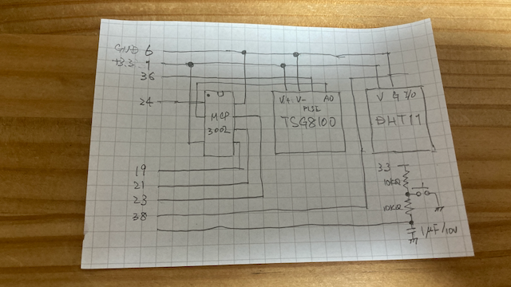

# Smell monitor (C++17)

Raspberry Pi 4 (BCM2711), Raspberry Pi OS 64-bit.

## Build

```sh
sudo apt install build-essential
make
sudo install -m 755 smell_monitor /usr/local/bin/smell_monitor
```

Enable SPI (`sudo raspi-config`) before running.
Run with permission to access `/dev/gpiomem`, `/dev/spidev0.0` and `/var/log/smell.log`.

## Source layout

- `GPIO.hpp`: BCM2835 GPIO memory mapping and I/O
- `MCP3002.hpp`: SPI ADC
- `TGS8100.hpp`: sensor PULSE and ADC sampling
- `DHT11.hpp`: temperature and humidity
- `CSVLogger.hpp`: CSV output
- `Event.hpp`: measurement request
- `SmellMonitor.hpp`: threads, queue, scheduler and switch polling
- `Common.hpp`: clock and signal flag
- `main.cpp`: entry point and signal handling

Each class is in its own header with inline method definitions. This retains the behavior of the previously supplied single-file implementation.

## Cautions

- This is **not** real-time pulse generation: Linux scheduling may extend the 2 ms PULSE limit. Verify with a scope/logic analyzer.
- Verify the MCP3002 SPI command and ADC decode against its datasheet and your wiring before relying on measurements.
- DHT11 bit timing is sensitive to scheduling jitter.
- DHT11 humidity is NOT so good. This humidity sensor wouldn't use.
- Switch events are accepted during the 20-minute warm-up.
- CSV: `/var/log/smell.log`.

## Pin assign

<table>
  <thead>
    <tr>
      <th>Raspberry Pi</th><th>Input Device</th>
    </tr>
  </thead>
  <tbody>
    <tr><td>1 +3.3V</td><td>MCP3002 8pin(Vdd/Vref)<br>TGS8100 V+<br>DHT110 V+</td></tr>
    <tr><td>6 GND</td><td>MCP3002 4pin(Vss)<br>TGS8100 V-</td></tr>
    <tr><td>19 MOSI</td><td>MCP3002 5pin (Din)</td></tr>
    <tr><td>21 MISO</td><td>MCP3002 6pin (Dout)</td></tr>
    <tr><td>23 SCLK</td><td>MCP3002 7pin (CLK)</td></tr>
    <tr><td>24 Digital I/O 8(Out)</td><td>MCP3002 1pin (CS)</td></tr>
    <tr><td>36 Digital I/O 16(Out)</td><td>TGS8100 PLUS</td></tr>
    <tr><td>38 Digital I/O 20(Out)</td><td>DHT110 GPIO</td></tr>
    <tr><td>40 Digital I/O 21(In)</td><td>Switch</td></tr>
  </tbody>
</table>

<p align="center">

</p>
